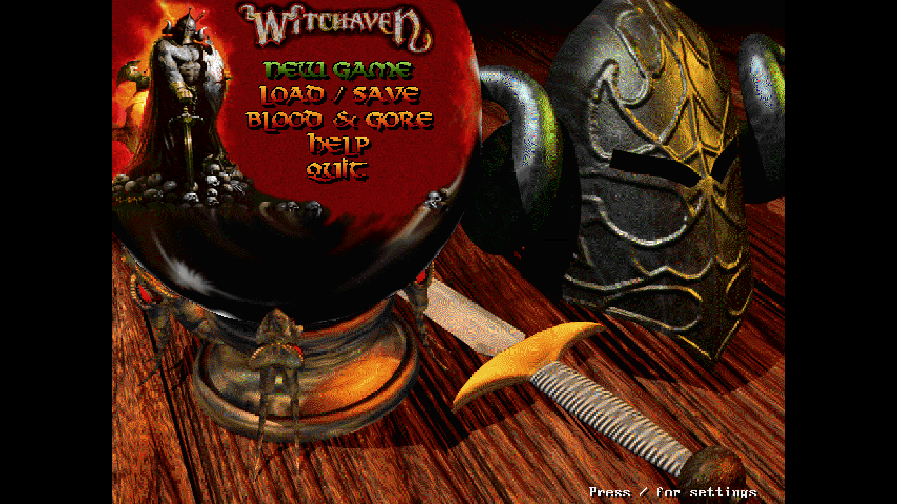
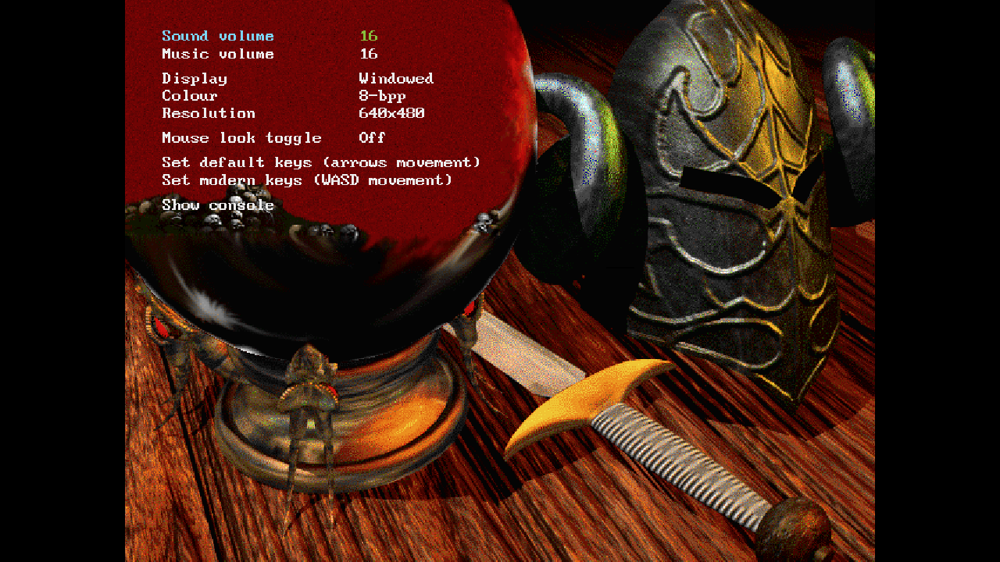
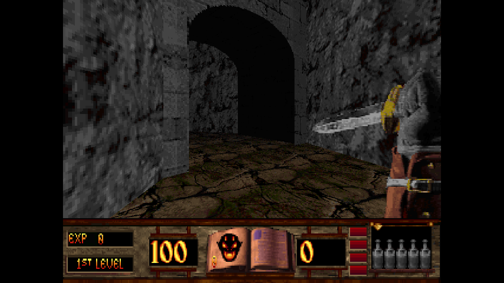
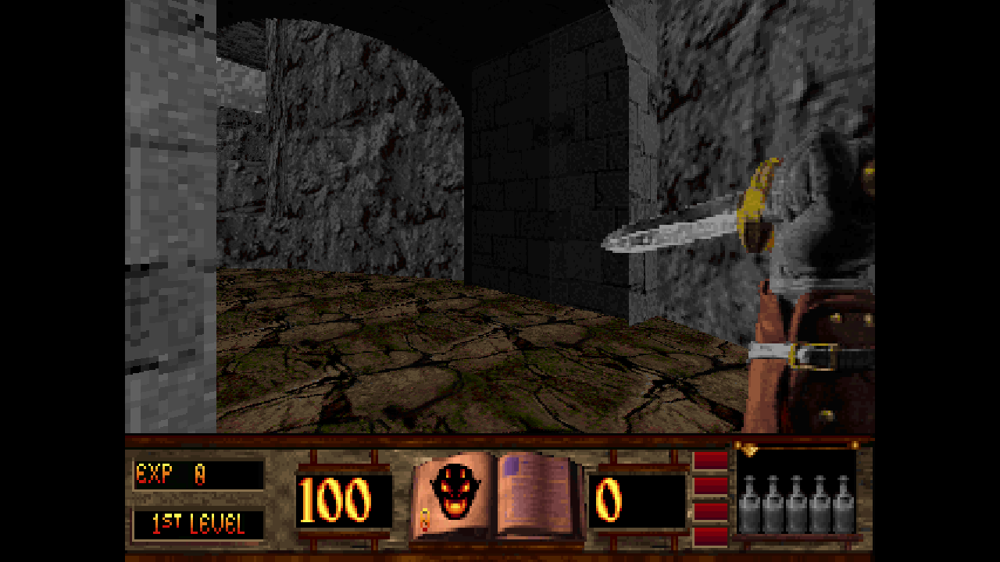
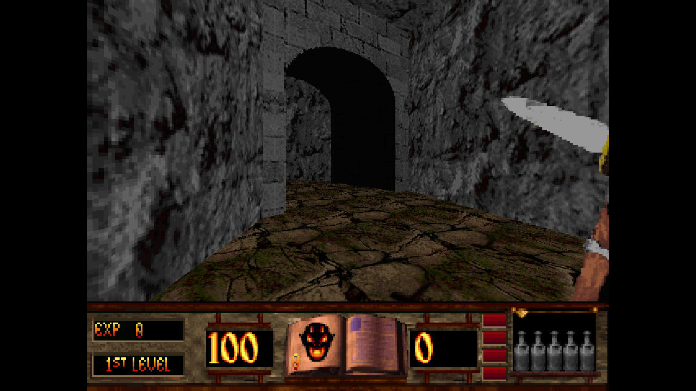
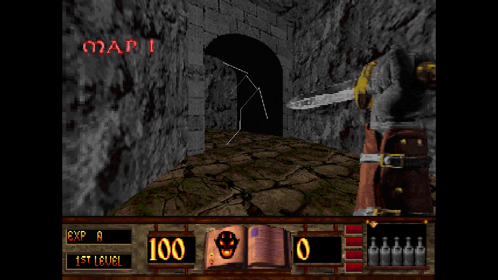

# Witchaven 360

Witchaven (Capstone Software, 1995) on an RGH, JTAG or Bad Avatar Xbox 360, from
[jfwhaven](https://github.com/jonof/jfwhaven), Jonathon Fowler's port of the source Les Bird released, built with
[xsdk](https://github.com/xenosworks/xsdk) and [SDL-xenon](https://github.com/xenosworks/SDL-xenon), as
[Heretic 360](https://github.com/owl8319-source/heretic360) is. The game runs on the Build engine's software
renderer, drawn 4:3 in the middle of the 720p display, with the controller and sound effects.

You need your own copy of Witchaven's data. It isn't included.



| | |
|---|---|
|  |  |
|  |  |
|  | |

The screenshots are the frames the port draws, framed in the 1280x720 display as the console shows them.

## Building (WSL Debian)

With xsdk built at `~/xsdk` and SDL-xenon built at `~/SDL-xenon/build-xsdk`, from this folder:

```
./build.sh
```

That makes `build/witchaven.xex`.

## Installing

Put `witchaven.xex` and Witchaven's data in one folder on the console, such as `Hdd1:\Homebrew\Witchaven\`, the data
files named in lower case, as the game asks for them:

- `tiles000.art` to `tiles010.art`
- `level1.map` to `level25.map` (and any others)
- `palette.dat`, `lookup.dat`, `tables.dat`
- `joesnd`, `songs`
- `intro.smk`, the intro film, if you have it (it's on the CD; without it the game starts at the menu)

From PowerShell, with the console's address and Aurora's FTP login, a file at a time:

```
curl.exe -T \\wsl.localhost\Debian\home\<you>\witchaven360\build\witchaven.xex --ftp-create-dirs ftp://<console>/Hdd1/Homebrew/Witchaven/ --user '<user>:<password>'
curl.exe -T C:\path\to\TILES000.ART ftp://<console>/Hdd1/Homebrew/Witchaven/tiles000.art --user '<user>:<password>'
```

Launch `witchaven.xex` from Aurora's file browser. The settings (`whaven.ini`), the saves (`svgn*.dat` and `svgm*.map`)
and the log, `witchaven.log`, are written beside it:

```
curl.exe ftp://<console>/Hdd1/Homebrew/Witchaven/witchaven.log --user '<user>:<password>'
```

## Controls

| In the game | | In the menus | |
|---|---|---|---|
| Left stick | move and strafe | Left stick or D-pad | up, down, left, right |
| Right stick | turn and look up or down | A | select |
| RT | attack | B or Start | back |
| LT | cast the chosen spell | Y | settings (main menu) |
| A | use (doors, switches) | | |
| B | jump | | |
| X | drink the chosen potion | | |
| Y | crouch | | |
| LB / RB | previous / next weapon | | |
| D-pad left / right | previous / next spell | | |
| D-pad up / down | next / previous potion | | |
| Left stick click | run, while held | | |
| Right stick click | centre the view | | |
| Back | map | | |
| Start | menu | | |

## What this version does and doesn't do yet

- **Does:** the game on the Build engine's software renderer, 640x480, drawn 4:3 in the middle of the 720p
  display; sound effects; the controller; settings. The game's data is read into memory as it starts, so play never
  waits on the hard drive.
- **Not yet:** music (Witchaven's songs are MIDI, and there's no MIDI player yet, so it plays silence); naming saves
  (the save screen wants a keyboard); widescreen.

## Layout

- `src/` is jfwhaven's game code, the files Witchaven needs.
- `jfbuild/` is the Build engine (Jonathon Fowler's port, jfbuild), the files the game needs, with Ken Silverman's
  licence (`jfbuild/buildlic.txt`).
- `jfaudiolib/` is the sound library (Apogee's audio library, in Jonathon Fowler's port), the files the game needs.
- `libsmacker/` plays the intro film.
- `xenon/` is the Xbox 360's side:
  - `xenonlayer.c`: the Build engine's platform layer, in place of jfbuild's SDL2 one (`sdlayer2.c`): video through
    xsdk's GPU layer (`blit.vert`, `blit.frag`, as Heretic 360's), the controller through SDL3, the timer, the log
    (written by its own thread once a second, so the game never waits on the drive to log a line) and start.
  - `wh_pad.c`: the controller turned into the keys and stick movement Witchaven reads, one layout in the game and
    another in the menus (it knows which by whether the game has read the controls in the last 200 ms).
  - `driver_sdl3.c`: jfaudiolib's sound output on SDL3, in place of its SDL2 `driver_sdl.c`.
  - `memfiles.c`: the game's data files read whole into memory the first time they're opened. The link wraps
    `open`, `read`, `lseek`, `close` and `fstat` (`CMakeLists.txt`) so the engine reads them from there.
  - `posix_shims.c`: `fstatat` and `times`, which newlib declares and xsdk doesn't provide.
  - `version.c`: the version jfwhaven's Makefile would otherwise take from git.

### What changed in jfwhaven's code

All under the `WITCHAVEN360` define.

- `jfbuild/include/compat.h`: the byte order from the compiler (`__BYTE_ORDER__`), for a compiler that isn't Linux's,
  the BSDs', macOS's or Windows'.
- `jfbuild/src/engine.c`: `loadtables` checks its sine and angle tables' checksums against the tables as a
  little-endian machine holds them, the 360 being big-endian; `buildsetlogfile` opens no second log (everything
  printed is already in `witchaven.log`, and that one wrote to the drive a line at a time).
- `src/whsndmod.c`: the tables of where each sound and song is in `joesnd` and `songs` are little-endian, as the PC
  wrote them, and are read so.
- `src/whaven.c`: always "portable": the settings and saves go beside the `.xex`.
- `src/whinp.c`: `getinput` tells `xenon/wh_pad.c` the game, not a menu, is reading the controls.

`CMakeLists.txt` builds with `-fsigned-char`: Witchaven and Build were written for x86, where `char` is signed.

## Changes

- **0.1:** first version: the game, sound effects, the controller; the data read into memory at startup (for the
  second's pause opening a door).

## Licence

Each part keeps its own: the Build engine is under Ken Silverman's licence (`jfbuild/buildlic.txt`: free,
non-commercial distribution only), jfaudiolib and `xenon/driver_sdl3.c` under the GPL 2 or later (`COPYING.md`),
libsmacker under the LGPL 2.1 or later. `NOTICES.md` has every notice a built `witchaven.xex` carries (the Build
engine, jfaudiolib, libsmacker, xsdk, SDL); it goes beside the `.xex` in a release. Witchaven's data is Capstone
Software's, not covered.
