# Witchaven 360

Witchaven (Capstone Software, 1995) on an RGH, JTAG or Bad Avatar Xbox 360, from
[jfwhaven](https://github.com/jonof/jfwhaven), Jonathon Fowler's port of the source Les Bird released, built with
[xsdk](https://github.com/xenosworks/xsdk) and [SDL-xenon](https://github.com/xenosworks/SDL-xenon), as
[Heretic 360](https://github.com/owl8319-source/heretic360) is. The game runs on the Build engine's software
renderer, in true widescreen, with the music, the opening film, the controller (with vibration), settings of its own,
quick save and a developer cheat menu.

You need your own copy of Witchaven's data. It isn't included.

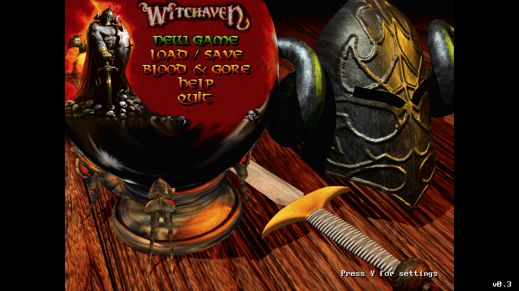

| | |
|---|---|
| 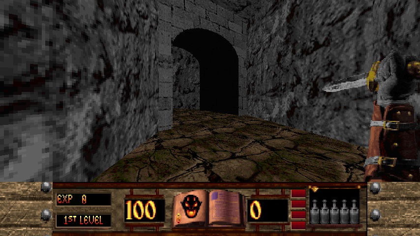 | 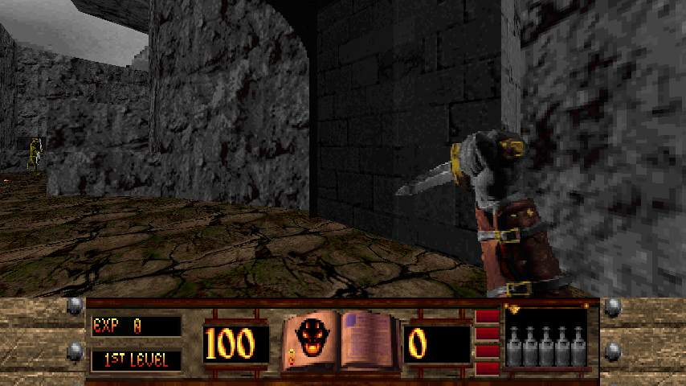 |
| 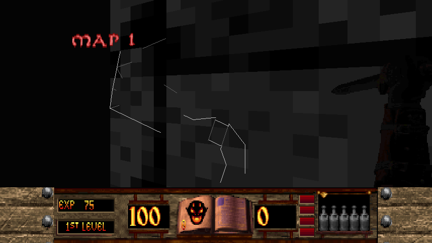 | 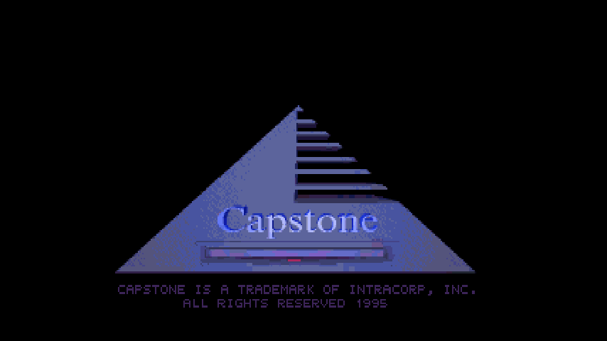 |
| 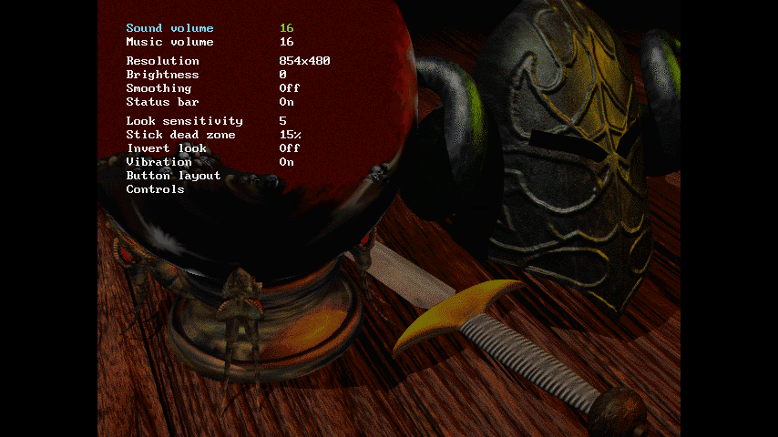 | 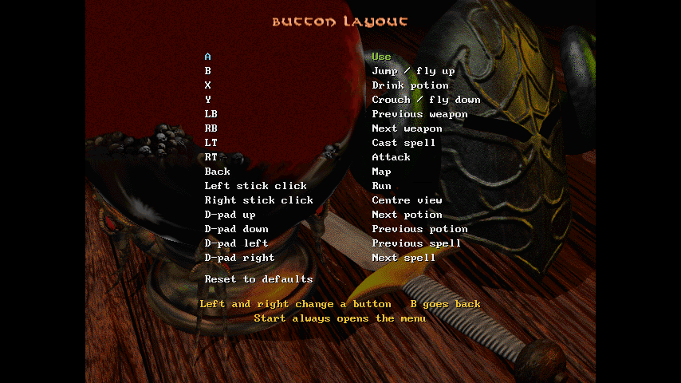 |
| 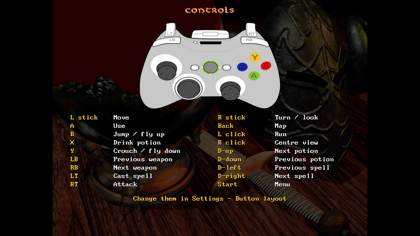 | 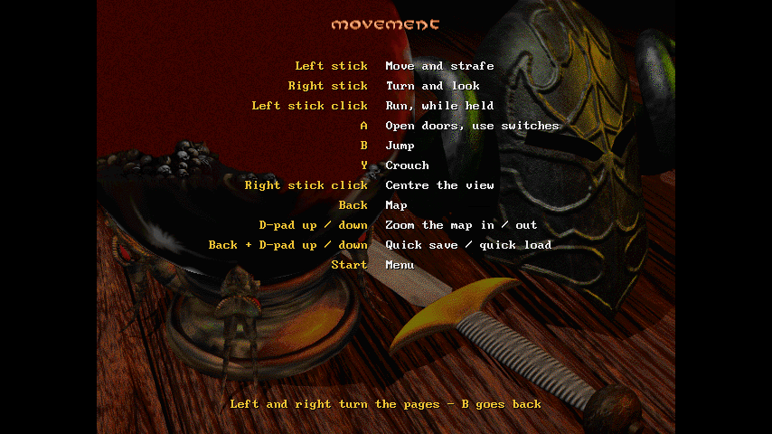 |
| 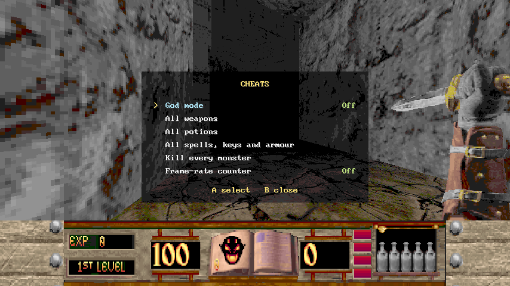 | 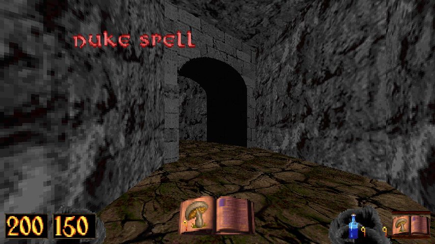 |

The screenshots are the frames the port draws, at the default 854x480, before the GPU's smoothing.

## Building (WSL Debian)

With xsdk built at `~/xsdk` and SDL-xenon built at `~/SDL-xenon/build-xsdk`, from this folder:

```
./build.sh
```

That makes `build/witchaven.xex`.

## Installing

Put `witchaven.xex` and Witchaven's data in one folder on the console, such as `Hdd1:\Homebrew\Witchaven\`, the data
files named in lower case, as the game asks for them:

- `tiles000.art` to `tiles010.art`
- `level1.map` to `level25.map` (and any others)
- `palette.dat`, `lookup.dat`, `tables.dat`
- `joesnd`, `songs`, `melodic.bnk`, `drum.bnk` (the last two are the AdLib instruments the music plays with)
- `intro.smk`, the opening film, from the CD's `WHAVEN` folder, if you have it (without it the game starts at the
  menu)

From PowerShell, with the console's address and Aurora's FTP login, a file at a time:

```
curl.exe -T \\wsl.localhost\Debian\home\<you>\witchaven360\build\witchaven.xex --ftp-create-dirs ftp://<console>/Hdd1/Homebrew/Witchaven/ --user '<user>:<password>'
curl.exe -T C:\path\to\TILES000.ART ftp://<console>/Hdd1/Homebrew/Witchaven/tiles000.art --user '<user>:<password>'
```

Launch `witchaven.xex` from Aurora's file browser. The settings (`whaven.ini`), the controller's (`controller.cfg`), the
saves (`svgn*.dat` and `svgm*.map`) and the log, `witchaven.log`, are written beside it:

```
curl.exe ftp://<console>/Hdd1/Homebrew/Witchaven/witchaven.log --user '<user>:<password>'
```

## Controls

| In the game | | In the menus | |
|---|---|---|---|
| Left stick | move and strafe | Left stick or D-pad | up, down, left, right |
| Right stick | turn and look up or down | A | select |
| RT | attack | B or Start | back |
| LT | cast the chosen spell | Y | settings (main menu) |
| A | use (doors, switches) | | |
| B | jump (flying: fly up) | | |
| X | drink the chosen potion | | |
| Y | crouch (flying: fly down, and land on the ground) | | |
| LB / RB | previous / next weapon | | |
| D-pad left / right | previous / next spell | | |
| D-pad up / down | next / previous potion | | |
| Left stick click | run, while held | | |
| Right stick click | centre the view | | |
| Back | map, on letting go (D-pad up / down zoom it) | | |
| Back + D-pad up / down | quick save / quick load | | |
| Start | menu | | |

A, B or Start skips the opening film. The buttons can be changed in Settings > Button layout (all but Start, which
always opens the menu); End flying (the PC's End key), Quick save and Quick load can be given one there. Settings >
Controls shows them on a picture of the controller, and the main menu's Help pages list them. Opening the Guide pauses
the game and its music. LB and RB act a tenth of a second late, so pressing both together does nothing (for the cheat
menu, below).

Quick save goes into a slot of its own (`svgm5.map`, `svgn5.dat`), not one of the Load / Save menu's five.

### Developer cheat menu

Hold **LB + RB + Back** for about a second during a level. The game pauses and a small menu opens over it, with cheats
that work on every difficulty:

| Cheat | Same as typing |
|---|---|
| God mode (on / off) | (new: Witchaven has none) |
| All weapons | `scooter` |
| All potions | `mommy` |
| All spells, keys and armour | `wango` (full health and level 7 too) |
| Kill every monster | (the nuke spell, on every monster in the level) |
| Frame-rate counter (on / off) | `showfps` (jfwhaven's) |

D-pad or left stick chooses, A selects, B closes. It isn't in the menus or Settings.

## What this version does

- The game on the Build engine's software renderer, in true widescreen: 854x480 by default (about 55-60 frames a
  second), or 1280x720 (sharper, but about 22-26 frames a second), 640x480 or the original 320x200 (Settings >
  Resolution), with the status bar's sides filled in with the game's own planks, and the weapons in the player's hands
  reaching the screen's edges: the few pictures wider than the original screen are widened on both sides.
- Smoothing (Settings): off, smooth, or sharp (the pixels' edges softened, not blurred), done by the GPU as the frame
  is drawn on the display.
- The status bar can be turned off (Settings), the view filling the screen, with a small HUD in the corners: health,
  armour, arrows or pikes, the potion and spell chosen.
- Sound effects, and the music played on an emulated OPL3 chip, as on an AdLib or Sound Blaster card.
- The opening film.
- Settings, on Y at the main menu: the sound and music volumes, the resolution, brightness, smoothing, the status
  bar, look sensitivity (with a gentler curve on the right stick), the sticks' dead zone, invert look, vibration, the
  button layout and a picture of the controls. The version is in the bottom right of the main menu.
- Help pages on the controls with the controller's buttons, as the layout has them, in place of the PC's keys.
- The map zooms with the D-pad; flying down to the ground lands; the Guide pauses the game and its music.
- Quick save and quick load, and a developer cheat menu.
- The frame rate in the log every 30 seconds.
- Saves named with the console's own keyboard.
- Vibration: the controller rumbles when the player is hurt (harder the more it hurts), as each weapon strikes, as a
  spell is cast and as something is picked up. It stops in the menus and when the Guide opens.
- The game's data is read into memory as it starts, so play never waits on the hard drive.

## Layout

- `src/` is jfwhaven's game code, the files Witchaven needs.
- `jfbuild/` is the Build engine (Jonathon Fowler's port, jfbuild), the files the game needs, with Ken Silverman's
  licence (`jfbuild/buildlic.txt`).
- `jfaudiolib/` is the sound library (Apogee's audio library, in Jonathon Fowler's port), the files the game needs.
- `libsmacker/` plays the intro film.
- `xenon/` is the Xbox 360's side:
  - `xenonlayer.c`: the Build engine's platform layer, in place of jfbuild's SDL2 one (`sdlayer2.c`): video through
    xsdk's GPU layer (`blit.vert`, `blit.frag`, with the smoothing), the controller through SDL3 (the music paused
    behind the Guide), the timer, the log
    (written by its own thread once a second, so the game never waits on the drive to log a line) and start.
  - `wh_pad.c`: the controller turned into the keys and stick movement Witchaven reads, one layout in the game and
    another in the menus (it knows which by whether the game has read the controls in the last 200 ms); the button
    layout, invert look, vibration, look sensitivity, the dead zone, the status bar and smoothing, kept in
    `controller.cfg`; quick save and load; the cheat menu's buttons.
  - `wh_menu360.c`: the Settings > Button layout and Settings > Controls pages, the Help pages on the controls, and
    the version on the main menu.
    `controls_art.h` is the controller picture (from `art/360_controller.svg`, by `tools/make_controls_art.py`).
  - `wh_xam.c`: the console's keyboard, for naming saves.
  - `wh_devmenu.c`: the developer cheat menu.
  - `driver_opl.c`: jfaudiolib's music driver: Witchaven's MIDI songs played on Nuked OPL3 (`opl/`) with the game's
    AdLib instrument banks.
  - `driver_sdl3.c`: jfaudiolib's sound output on SDL3, in place of its SDL2 `driver_sdl.c`.
  - `memfiles.c`: the game's data files read whole into memory the first time they're opened. The link wraps
    `open`, `read`, `lseek`, `close` and `fstat` (`CMakeLists.txt`) so the engine reads them from there.
  - `posix_shims.c`: `fstatat` and `times`, which newlib declares and xsdk doesn't provide.
  - `version.c`: the version jfwhaven's Makefile would otherwise take from git.

### What changed in jfwhaven's code

All under the `WITCHAVEN360` define.

- `jfbuild/include/compat.h`: the byte order from the compiler (`__BYTE_ORDER__`), for a compiler that isn't Linux's,
  the BSDs', macOS's or Windows'.
- `jfbuild/src/engine.c`: `loadtables` checks its sine and angle tables' checksums against the tables as a
  little-endian machine holds them, the 360 being big-endian; `buildsetlogfile` opens no second log (everything
  printed is already in `witchaven.log`, and that one wrote to the drive a line at a time).
- `src/whsndmod.c`: the tables of where each sound and song is in `joesnd` and `songs` are little-endian, as the PC
  wrote them, and are read so.
- `jfaudiolib/src/assmisc.h`: the byte order from the compiler too, so the MIDI player reads the songs right.
- `jfaudiolib/src/drivers.c`: the music goes to `xenon/driver_opl.c`.
- `src/whaven.c`: always "portable": the settings and saves go beside the `.xex`; 854x480 to start; the sides of the
  status bar filled in; `lookup.dat` read before the opening film (the drive spins down while it plays); the status
  bar setting applied on leaving the menu; the HUD and the cheat menu drawn; quick save and load done between frames.
- `src/whinp.c`: `getinput` tells `xenon/wh_pad.c` the game, not a menu, is reading the controls; the sticks' dead
  zone left to `wh_pad.c`; flying down to the ground lands, at standing height.
- `src/whsndmod.c`: the AdLib arrangement of each song, and the menu's two songs.
- `src/whmenu.c`: the Settings items and pages (and Brightness, the PC's F10), "Press Y for settings" and the version
  on the main menu, the keyboard on the save screen, the Help pages on the controls, and quick save and load.
- `src/whsmk.c`: the opening film's sound at full volume, as the DOS player had it.
- `src/whplr.c`, `src/whobj.c`: the vibration: when the player is hurt, a weapon strikes, a spell is cast, something
  is picked up. `whplr.c` also moves the weapons out to the edges of a widescreen display, and clears the eight spells,
  not nine (the ninth was written into the treasures and potions); it draws the HUD with the status bar off; nothing
  hurts in god mode.
- `src/whani.c`: god mode.
- `libsmacker/smacker.c`: a check on the film's palette changes that refused one Witchaven's film makes (its colours
  are copied from a copy, so a source overlapping the colours being written is fine).

`CMakeLists.txt` builds with `-fsigned-char`: Witchaven and Build were written for x86, where `char` is signed.

## Changes

- **0.3:** look sensitivity and dead-zone settings, with a gentler right stick; smoothing (off, smooth, sharp); the
  status bar can be turned off, with a small HUD; a developer cheat menu (LB + RB + Back); quick save and quick load
  (Back + D-pad up / down); the weapons sized to the view, so a swing's top stays on screen, and the widest pictures
  widened at both sides; the music pauses behind the Guide; landing from flight at standing height; weapon and spell
  changes no longer sometimes missed; the frame rate in the log.
- **0.2.1:** the weapons full size in widescreen, reaching the screen's edges; Help pages with the controller's
  buttons; Brightness in Settings; the map zooms with the D-pad; flying down to the ground lands, and End flying can be
  given a button; the Guide pauses the game; the opening film's colours right throughout, and no pause after it.
- **0.2:** true widescreen; the music; the opening film; Settings pages for the button layout and controls; invert
  look; vibration; saves named with the console's keyboard; the version on the main menu.
- **0.1:** first version: the game, sound effects, the controller; the data read into memory at startup (for the
  second's pause opening a door).

## Licence

Each part keeps its own: the Build engine is under Ken Silverman's licence (`jfbuild/buildlic.txt`: free,
non-commercial distribution only), jfaudiolib and `xenon/driver_sdl3.c` under the GPL 2 or later (`COPYING.md`),
libsmacker and Nuked OPL3 under the LGPL 2.1 or later, the controller picture under CC BY-SA 3.0 (`art/README.md`). `NOTICES.md` has every notice a built `witchaven.xex` carries (the Build
engine, jfaudiolib, libsmacker, Nuked OPL3, the controller picture, xsdk, SDL); it goes beside the `.xex` in a release. Witchaven's data is Capstone
Software's, not covered.
